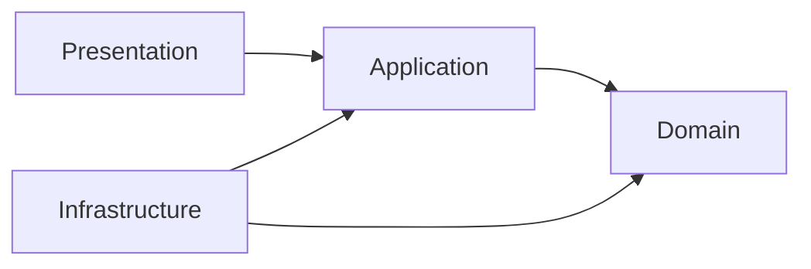

# Arquitetura

Aplicativo modular com Expo Router e TypeScript strict. Há uma rota estática, domínio/casos de uso de membros (entregas 01/02) e planejamento de manutenções (entrega 03). Não existem adaptadores de persistência, autenticação ou telas de membros.

## Direção das dependências

Domain contém entidades, invariantes e contratos em TypeScript independente de frameworks. Application orquestra os casos de uso e recebe portas explicitamente. Infrastructure implementa integrações e persistência. Presentation contém telas, componentes e estado de interface. `app/` é a entrada do Router e delega a apresentação.

Quando houver necessidade real, um ponto de composição na borda instanciará adaptadores e os entregará aos casos de uso. Não criar contêiner de injeção, serviços globais ou repositórios genéricos antecipadamente. Não importar Infrastructure em Domain ou Application; não passar tipos Supabase para o domínio. Regras de negócio não pertencem a componentes React. Ciclos entre módulos são proibidos.

O ESLint aplica restrições de importação por camada e detecta ciclos. O compilador garante strict, propriedades opcionais exatas e acesso indexado verificado. Importações externas são validadas na fronteira usando Zod, com erros explícitos e conversão para tipos internos; não usar `any` para contornar contratos.

## Backend e persistência — decisão pendente

O PRD oficial do MVP 1.0 mantém a tecnologia do backend em aberto. Supabase/PostgreSQL foi uma alternativa considerada no bootstrap; não é uma decisão definitiva e não está instalado. Qualquer adaptador futuro ficará em Infrastructure, consumindo contratos internos sem expor tipos do fornecedor ao domínio. Não criar SDK, banco ou migração só por existir `.env.example` com nomes Supabase.

A escolha deverá atender autorização no servidor, revogação de sessões/dispositivos, persistência central, transações, sincronização, fotos e agendamento de notificações sem depender do aplicativo aberto. Se PostgreSQL/Supabase for escolhido, avaliar RLS e funções com privilégios mínimos; outras soluções deverão demonstrar garantias equivalentes. O MVP não inclui suporte completo a várias congregações; manter o escopo dos dados nos contratos existentes não autoriza construir essa funcionalidade.

Autenticação sem e-mail e senha e ativação por token temporário de uso único continuam requisitos, com mecanismo técnico a validar. Cadastro, identidade autenticada e dispositivo permanecem separados. Nenhuma chave pública ou papel fornecido pelo cliente substitui uma sessão validada. Ver SECURITY e ADR-003.

## Testes e evolução

Vitest em Node testa TypeScript puro e integração de tooling. Futuras regras exigem testes de comportamento e falhas. Testes de componentes e ponta a ponta serão escolhidos quando existirem fluxos reais, sem simular segurança inexistente. Exportação web valida Metro/Router; testes nativos continuam necessários antes de distribuição. Novas dependências e decisões estruturais devem ser justificadas por necessidade e ADR quando relevante.

## Módulo de membros — entregas 01 e 02

`src/domain/members` contém `Member` imutável, tipos, erros e contrato de repositório sem exclusão. `src/application/members` contém sete casos de uso reunidos em `MemberUseCases`, erros e portas de transação, auditoria, atribuições futuras, relógio e identificadores. Não há abstrações genéricas, contêiner de injeção ou serviços globais. Testes ficam em `tests/members`, permitindo que o domínio continue sem imports de bibliotecas de testes.

A unidade de trabalho mantém a orquestração independente de banco e tarefas. Ela exige atomicidade e serialização no servidor; o adaptador em memória existe somente em testes e não constitui autenticação ou implementação de produção. Projeções de saída omitem telefone de solicitantes que não sejam administradores ativos, inclusive após autodesativação ou rebaixamento. Instâncias `Member` e `toRecord()` são objetos internos com telefone; não devem ser serializados diretamente para respostas públicas. Ver ADR-002.

## Diretrizes do MVP 1.0 — ainda não implementadas

A divisão em camadas permanece. Persistência local e sincronização pertencem a adaptadores, enquanto deduplicação, estados válidos e regras de conflito precisam de contratos explícitos. As opções de banco local, protocolo e bibliotecas não foram escolhidas.

- Representar alterações por operação/tarefa, sem substituir o checklist inteiro. Combinar alterações independentes, deduplicar conclusões e preservar registros distintos de problemas. Resultados incompatíveis exigem revisão; não adotar silenciosamente a última cópia como vencedora.
- Mostrar sincronizado, aguardando envio e conflito. Revalidar autorização no servidor no recebimento de operações offline. O tratamento de operações recusadas, fotos e encerramento concorrente ainda precisa ser detalhado, sem descartar trabalho silenciosamente.
- Tratar disponibilidade e designação como planejamento, nunca presença ou avaliação. Resultados de tarefa e registros de problemas são distintos: um problema não desaparece quando a tarefa é concluída.
- Modelar ocorrências separadamente da recorrência. Reagendamento invalida avisos antigos e recalcula futuros; cancelamento definitivo afeta a ocorrência e preserva o registro técnico, sem restauração no MVP.
- Executar notificações no servidor com deduplicação, validação de atualidade, silêncio coletivo e exceção de prioridade conforme o PRD. Central interna e entrega push são conceitos separados; entrega imediata continua sujeita à conectividade e ao sistema operacional.
- Manter a proteção do último administrador e a unidade de trabalho da entrega 01 como contratos. O backend escolhido deverá garantir atomicidade real entre desativação, retirada de designações e auditoria; uma fila offline do cliente não cumpre essa transação por si só.

A entrega 02 implementa a política de consulta do PRD: solicitantes ativos podem consultar a equipe ativa; administradores também veem inativos e telefones. O filtro de situação ocorre antes da projeção e a propriedade de telefone é omitida para não administradores. A restrição de escrita não mudou. Sem sessão confiável resolvida no servidor, esses casos de uso não são uma API autenticada.

## Concorrência otimista de membros — entrega 02

`Member.version` é restaurada explicitamente, começa em 1 na criação e avança em cada alteração efetiva. Todas as mutações existentes exigem `expectedVersion`. A aplicação faz uma verificação inicial na unidade de trabalho para rejeitar requisições obsoletas; essa verificação sozinha não é a garantia de persistência.

`MemberRepository.saveIfVersion` exige comparação e gravação atômicas no armazenamento, com escopo por identificador/congregação/versão e retorno indicativo de sucesso. Não há mais método de atualização irrestrita. O futuro adaptador deve usar escrita condicional e conferir o resultado (por exemplo, quantidade de linhas alteradas), sem separar leitura da comparação e gravação. Um falso gera conflito antes de executar efeitos. Auditoria inclui versões anterior/posterior, sem valores pessoais.

O controle de versão por membro não impede duas desativações simultâneas de administradores diferentes. Portanto, a serialização e o bloqueio adequados ao conjunto de administradores da congregação continuam obrigatórios no servidor, junto da transação que inclui designações e auditoria. Os testes só exercitam o contrato em memória. Ver ADR-004 para no-ops, erros, alternativas e limites.

## Planejamento de manutenções — entrega 03

`src/domain/maintenance` contém calendário civil, categorias/configuração, `RecurrenceRule`, `MaintenanceOccurrence`, erros e contratos de repositórios. `src/application/maintenance` orquestra casos de uso com leitura de membros existentes, transações, IDs, relógio e eventos duráveis. Não há import de SDK, React ou Infrastructure nas camadas internas. Os testes ficam em `tests/maintenance`, com adaptador somente de testes.

Regra aprovada e ocorrência são agregados separados. A chave de geração usa congregação, regra e ciclo estável (`cycleKey`), independente do dia de execução; unicidade e CAS devem ser garantidos no armazenamento. Configurações individuais não se propagam a irmãos de série e revisões de regra não sobrescrevem o existente. Regras guardam histórico imutável de revisões com `effectiveFrom` explícito. O calendário seleciona a configuração pela referência civil do ciclo (sábado ou dia 1 do mês), preservando a categoria e a ancoragem original. A origem guarda a versão aplicada; a inserção atômica devolve qualquer ciclo já materializado intacto. A geração exige intervalo explícito e limitado; não há cron ou tarefa infinita. Ver ADR-005 para vigências no meio do ciclo, mudanças de dia e reidratação sem fallback de campos legados.

Eventos transacionais são o contrato de histórico técnico/outbox para invalidação de lembretes e notificação posterior. O consumidor futuro deve verificar versão/situação atual antes de enviar. Disponibilidade usa revisão para preservar ou pedir reconfirmação, sem módulo real de respostas. `AudioTeamSchedule` é porta interna de IDs da equipe, sem presumir formato/API do Hourglass e sem chamada real nesta entrega.

Data, horário e fuso são explícitos; a aritmética de datas não resolve instantes UTC nem ambiguidades DST. A retirada de designações por desativação deve futuramente compartilhar uma transação com o módulo de membros, não compor dois callbacks independentes. Ver ADR-005; os contratos não provam persistência, autorização, notificações ou offline de produção.

## Convites e disponibilidade — entrega 04

`AvailabilityPlan` é agregado independente por congregação/ocorrência/`availabilityRevision`, com CAS próprio, janela, público reconciliado e última resposta por membro. “Sem resposta” é calculado, não um registro negativo. Domínio depende apenas de contratos/tipos internos; aplicação lê membros/ocorrências e injeta relógio e transações. Não altera a entidade de manutenção nem suas designações para responder.

`AvailabilityUseCases` oferece configuração, resposta, consulta própria, totais autorizados, encerramento/reabertura e entradas confiáveis para agendamento/reconciliação. `refreshIn` recebe a unidade de trabalho compartilhada com a alteração de membro/designação/cancelamento; a futura composição deve usá-la na mesma transação, sem duas transações remotas independentes. Consultas/respostas revalidam os dados atuais. Eventos e jobs precisam ser gravados atomicamente, sem adapter de produção nesta entrega.

A guarda `now >= deadline` independe de job ou UI. Jobs identificados por revisão/geração são obsoletos após reconfirmação/reabertura; executor real precisa garantir execução e retries, nunca consumir definitivamente uma entrega antecipada. Convites incluem geração de elegibilidade por destinatário; `invitationIsCurrent` revalida escopo, situação, revisão, público, prazo, geração e ausência de resposta. Fechamento seguido de reabertura registra a geração fechada e a nova geração separadamente. Ver ADR-006.

## Ajustes finais de disponibilidade e retenção

`MaintenanceUseCases.reschedule` exige `ResponseDeadlineDecision` além da decisão de respostas. Um hook obrigatório de `MaintenanceUnitOfWork.lifecycle` aplica janela/prazo dentro da transação existente; no cancelamento, outro hook descarta todas as revisões. Conflitos e falhas de jobs/eventos/descarte revertem também a ocorrência. `TechnicalMaintenanceHistory.record` recebe somente a projeção `MaintenanceTechnicalSnapshot`, incluindo a criação; o adaptador preserva a primeira agenda e atualiza por identidade/versão sem contar edições como novas manutenções.

`AvailabilityRetention` mantém marcador terminal sem pessoa, remove janelas/convites/eventos individuais/jobs e bloqueia replay/reconfiguração. Caches, logs, cópias offline, backups e restaurações exigem implementação própria. `TechnicalCompletionReceipt`, `AvailabilityCompletionIntegration` e `AnnualMaintenanceHistory` são contratos para a conclusão técnica futura, não uma alteração artificial de `MaintenanceOccurrence.status` para completed. O estado atual só admite scheduled/cancelled. O fato anual não contém disponibilidade por pessoa; painel e critério do ano de remarcações não foram implementados.

A auditoria anterior usa snapshots completos com identificadores de atores/equipes. A projeção minimizada não transforma automaticamente esses payloads em anônimos; o futuro adaptador deve minimizá-los no descarte e decidir esquema de retenção. Ver ADR-006. Alterar apenas o prazo mantém o fluxo explícito de reabrir uma janela já encerrada, sem inferir uma nova política de estado.

## Reconciliação transacional de público — correção da entrega 04

`assignTeam` e `configure` exigem `lifecycle.availabilityAudienceChanged` quando modalidade ou designados mudam. O adaptador liga esse hook ao `refreshIn` usando a unidade de trabalho já aberta. O fluxo mantém CAS da ocorrência, registro técnico, evento de manutenção, reconciliação/CAS da janela e eventos de disponibilidade dentro de um único commit. Nenhuma retirada/reinclusão pode desaparecer entre leituras assíncronas do estado final. Permissões, isolamento, versão esperada e rollback continuam obrigatórios no servidor.

A reconciliação preserva quem continua elegível, não cria janela ausente nem revive disponibilidade descartada e só emite convite se a janela estiver aberta. Configurações sem mudança de público não a disparam. Testes de integração usam os casos de uso reais sem chamadas manuais a `refresh` para compensar o hook.

**Obrigatório antes da produção:** minimizar identificadores em ocorrências terminais, especialmente `assignedMemberIds` e `responsibleMemberIds`, incluindo saídas integrais, snapshots, eventos, projeções e persistência futura. A auditoria demonstrou que referências ainda podem ser retornadas após cancelamento. Não remover dados operacionais necessários de ocorrências ativas. Sem adaptadores reais, não declarar validação de exclusão física; ver ADR-006 e SECURITY.

## Checklists e conclusão técnica — ADR-007

`domain/checklists` contém ChecklistTemplate, MaintenanceChecklist, TechnicalProblem, tipos, erros e portas de repositório. `application/checklists` contém ChecklistUseCases e contratos da unidade de trabalho. Modelos usam pares tarefa/categoria e versões; snapshots protegem checklists existentes. Problemas independentes preservam histórico mesmo quando o resultado é corrigido. Não há campos de executor, atribuição ou presença.

A conclusão introduz `completed` como estado terminal real. A unidade de trabalho compartilha membros/ocorrências/checklists/problemas, recibos idempotentes, histórico anual, retenção e eventos técnicos. Concluir sela resultados e registra hora real no snapshot/recibo anual; correção administrativa preserva antes/depois sem nova conclusão. Todos os efeitos e CAS são atômicos por contrato, com rollback. O adaptador deve coordenar leituras de autorização/estado com escritas concorrentes; CAS isolado do checklist não basta. `refresh` recusa reconstrução de disponibilidade para concluídas sem marcador terminal.

O adaptador em testes serializa a unidade de trabalho e injeta falhas, sem provar atomicidade entre processos. Não há banco, transporte, autenticação ou sincronização offline. Versões são conservadoras por agregado, não resolução avançada por item. Fotos são referências opacas; matriz oficial ainda não foi importada/validada. Histórico anual mantém fatos por ocorrência sem pessoas e sem decidir o ano de remarcações entre anos.
