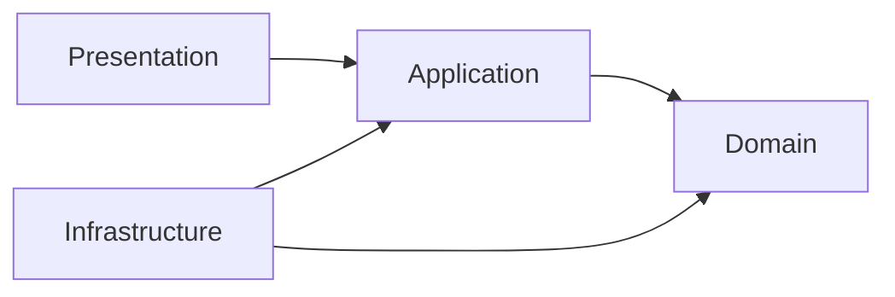

# Arquitetura

Aplicativo modular com Expo Router e TypeScript strict. Nesta etapa há uma rota estática e a estrutura mínima para evolução; não existem casos de uso, persistência ou autenticação.

## Direção das dependências

Domain contém entidades, invariantes e contratos em TypeScript independente de frameworks. Application orquestra os casos de uso e recebe portas explicitamente. Infrastructure implementa integrações e persistência. Presentation contém telas, componentes e estado de interface. `app/` é a entrada do Router e delega a apresentação.

Quando houver necessidade real, um ponto de composição na borda instanciará adaptadores e os entregará aos casos de uso. Não criar contêiner de injeção, serviços globais ou repositórios genéricos antecipadamente. Não importar Infrastructure em Domain ou Application; não passar tipos Supabase para o domínio. Regras de negócio não pertencem a componentes React. Ciclos entre módulos são proibidos.

O ESLint aplica restrições de importação por camada e detecta ciclos. O compilador garante strict, propriedades opcionais exatas e acesso indexado verificado. Importações externas são validadas na fronteira usando Zod, com erros explícitos e conversão para tipos internos; não usar `any` para contornar contratos.

## Preparação para Supabase/PostgreSQL

Supabase é a integração planejada, não instalada nem necessária para iniciar. Futuramente seus adaptadores ficarão em Infrastructure, com contratos consumidos por Application. Migrações serão versionadas quando o modelo for aprovado. PostgreSQL deverá aplicar políticas de isolamento por congregação e autorização no servidor (RLS e funções/serviços com privilégios mínimos). A chave pública do cliente não substitui autorização.

Autenticação sem e-mail requer investigação específica: avaliar recursos suportados de Supabase Auth e/ou um serviço confiável de provisionamento e troca de tokens. Não pressupor que uma chave pública implemente autenticação ou que um token de ativação seja uma sessão. Ver SECURITY.

## Testes e evolução

Vitest em Node testa TypeScript puro e integração de tooling. Futuras regras exigem testes de comportamento e falhas. Testes de componentes e ponta a ponta serão escolhidos quando existirem fluxos reais, sem simular segurança inexistente. Exportação web valida Metro/Router; testes nativos continuam necessários antes de distribuição. Novas dependências e decisões estruturais devem ser justificadas por necessidade e ADR quando relevante.
